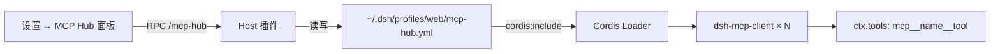

# dsh-mcp-hub

DSH 插件：**可视化 MCP 服务器管理 + 多格式导入**。

在 Web GUI 的 **设置 → MCP Hub** 里管理 MCP 服务器：查看列表与连接状态、启动 / 关闭、
测试连接、增删改，并把 Codex / Claude / Cursor / VS Code 的 MCP 配置一键导入。

## 解决的问题

DSH 里每个 MCP 服务器是一行 `@deepseek-ai/dsh-mcp-client` 的 Loader 条目，
平时要手改 YAML。本插件提供一个面板来做这件事，并且**能直接吃各家客户端的配置格式**，
不用手工翻译成 DSH 的写法。

## 功能

| 功能 | 说明 |
| --- | --- |
| 列表可视化 | serverName、传输方式、目标（URL / 命令）、启用状态、加载阶段、已注册工具数 |
| 启动 / 关闭 | 写回配置文件并触发热重载；关闭立即断开该服务器工具，开启立即连上 |
| 连接测试 | 真握手 `initialize` → `tools/list`，报告工具数与耗时；失败给出可读原因 |
| 增 / 删 / 改 | 表单编辑，含 stdio 与 streamable-http 两种传输 |
| **多格式导入** | Codex TOML、`mcpServers` JSON、VS Code `servers` JSON、顶层单对象 JSON |
| 导入来源 | 粘贴文本、填绝对路径读取、扫描本机已知位置（Codex / Claude / Cursor / Gemini / VS Code） |
| 密钥保护 | 导入时把 `PASSWORD` / `TOKEN` / `KEY` / `SECRET` 等值替换为占位符，并提示补填 |

### 支持的导入格式

**1. Codex（`~/.codex/config.toml`）**

```toml
[mcp_servers.idea]
type = "http"
url = "http://127.0.0.1:64342/stream"

[mcp_servers.mysql-dev]
type = "stdio"
command = "/usr/bin/npx"
args = ["-y", "mysql-mcp-server"]

[mcp_servers.mysql-dev.env]
MYSQL_HOST = "dev.example.com"
MYSQL_PASSWORD = "secret"     # 导入后变成占位符，需在面板补填
```

**2. Claude Desktop / Cursor 等 `mcpServers` JSON**

```json
{
  "mcpServers": {
    "idea": { "enabled": true, "type": "remote", "url": "http://127.0.0.1:64342/stream" }
  }
}
```

**3. 裸 JSON（无外层键）**

```json
{ "idea": { "url": "http://127.0.0.1:64342/stream", "type": "http" } }
```

**4. VS Code（`.vscode/mcp.json`，允许注释与尾逗号）**

```json
{
  "servers": {
    "idea": { "type": "http", "url": "http://127.0.0.1:64342/stream" }
  }
}
```

传输别名会被归一化：`http` / `remote` / `streamable-http` / `sse` → `streamable-http`；
`stdio` / `local` → `stdio`。缺 `type` 时按 `command` / `url` 自动判定。

## 三种导入方式

| 方式 | 说明 |
| --- | --- |
| 粘贴配置文本 | 把上面的任意格式粘进文本框 |
| 从本地文件导入 | 填路径（支持 `~`），或点「扫描本机已知位置」后按行读取 |
| 扫描本机已知位置 | 探测下面的已知路径并显示各有多少台 |

### 会扫描哪些位置

按平台给出各自真实的位置（不会把三个平台的路径混列一遍，避免显示不存在的位置）：

| 工具 | 位置 |
| --- | --- |
| Codex | `~/.codex/config.toml` |
| Claude Code | `~/.claude.json`、`~/.claude/settings.json` |
| Cursor | `~/.cursor/mcp.json` |
| MCP CLI | `~/.config/mcp/config.json` |
| **Gemini / Antigravity** | **`~/.gemini/config/mcp_config.json`** |
| Gemini（旧位置） | `~/.gemini/settings.json` |
| Antigravity | `~/.gemini/antigravity*/mcp_config.json`、`~/.antigravity/mcp_config.json` |
| VS Code | `~/.vscode/mcp.json`、用户级 `mcp.json`（按平台） |
| Windsurf | `~/.codeium/windsurf/mcp_config.json` |
| Claude Desktop | macOS `~/Library/Application Support/Claude/…`；Windows `%APPDATA%\Claude\…`；Linux `~/.config/Claude/…` |

两个容易忽略的点：

- **Gemini / Antigravity 的真实配置在 `~/.gemini/config/mcp_config.json`**，不在
  `~/.gemini/settings.json`。后者通常只剩 `{"mcpServers": {}}`（空），
  `~/.gemini/config/` 目录里有个 `.migrated` 标记文件，正是从旧位置迁过去的痕迹。
  只扫旧位置会永远发现不了这份配置。
- **跳过没有 MCP 条目的文件**。`~/.gemini/config/config.json`、
  `~/.claude/settings.json` 这类文件装的是主题、权限、`statusLine`，
  列出「0 台」只会让人以为插件找错了地方，所以扫描结果里不出现。

> 顺带：Antigravity 的 `~/.gemini/antigravity/mcp/<服务器名>/*.json` 是**工具 schema
> 缓存**（里面是 `xdebug_get_stack.json` 这类单个工具的描述），**不是** MCP 配置，
> 插件不会去读它们。

### 导入前可以逐条勾选

解析结果会列成一个**可勾选清单**，只有勾中的才会写入。默认规则：

- 与已有服务器**重名**的条目默认**不勾**（面板上会显示 `idea → idea-2` 这类改名提示），
  避免在不知情的情况下多导一台重复的进来；
- 不冲突的条目默认勾选；
- 未勾中的条目**不会占用 serverName**，你之后再单独导入它时仍是原本的名字
  （不会变成 `idea-2`）。

清单上方有「全选 / 全不选」。底部实时显示「已勾选 N 台」。

**读取文件时不会把文件原文回传界面。** 像 `~/.codex/config.toml` 这种文件，绝大部分内容
（`model_provider`、`sandbox_mode`、`approval_policy` …）与 MCP 无关；把它们倒进文本框既是
噪音，也可能把 `env` / `headers` 里的密钥显示到浏览器上。

所以「读取」是**就地解析**：解析在 Host 侧完成，界面只收到解析出的服务器清单。面板显示
「已从 /path 解析出 N 台服务器」，配合勾选清单一起看。解析永远在 Host 完成，
Client 只拿到规划后的结果 —— 这也是 `lib/selftest.mjs` 里那条
「返回值不含文件原文」断言在守的行为。

### 已有的服务器：接管（adopt）

如果某台服务器的行写在**别的插件**的配置文件里（例如 `cordis.patch.yml` 由
`dsh-mcp-manager` 写），本插件按设计不去改别人的文件，所以它在面板上是只读的
（标「外部配置」，按钮禁用）。

点该行展开后的 **接管** 按钮，可以把它搬进本插件名下：

1. 先在来源文件旁生成备份 `<file>.bak-<时间戳>`；
2. 从来源文件里**行级摘除**这一行（保留注释与其余内容，不做整文件重写）；
3. 并入 `mcp-hub.yml`，此后可正常启停 / 编辑 / 删除。

摘除只动目标行：`lib/adopt-e2e.test.mjs` 会断言「除目标行外逐行一致」，包括注释。

写入前会加与宿主 `dsh-config-editor` **同一把锁**（`<file>.lock`），
并用原子写落盘，避免两个写入方互相覆盖 —— 详见下面设计说明第 3 条。

### 导入时的两个提醒

- **密钥变占位符**：`env` / `headers` 里名字含 `pass` / `secret` / `token` / `key` /
  `credential` / `auth` 的值会被替换为 `__DSH_MCP_HUB_SET_ME__`，条目标为「待补密钥」，
  需要你在面板里手动填回。
- **远程传输的 `env` 会被忽略**：`dsh-mcp-client` 的 `streamable-http` 分支只读
  `url` 和 `headers`，没有 `env` 字段。遇到这种配置会给出**告警**（而不是静默丢弃），
  提示你改写成 HTTP header。反之，`stdio` 传输不支持 `headers`，同样会告警。

## 数据放在哪

本插件**独占**一个文件，默认位于 **profile 目录内**：
`$DSH_HOME/profiles/<profile>/mcp-hub.yml`（权限 0600），可通过行的 `dataFile` 覆盖。

> **为什么放在 profile 目录里，而不是 `$DSH_HOME/mcp-hub.yml`：**
> 数据文件持有 `@deepseek-ai/dsh-mcp-client` 行，而 dsh 启动时的兼容性预检会
> **从声明该行的文件自身**向上解析这个裸包名：
>
> ```js
> createRequire(pathToFileURL(<include 文件>)).resolve.paths('@deepseek-ai/dsh-mcp-client')
> ```
>
> 文件放在 `$DSH_HOME` 下，会一路向上找到 `$DSH_HOME` 的**父目录**的
> `node_modules`。如果那里残留一份旧 dsh 安装（例如工作区 `package.json` 里写着
> `@deepseek-ai/dsh: ^0.1.2-rc.1`），就会命中旧版 `dsh-mcp-client`；peer 校验
> 失败后 dsh 会**整体禁用这个 include**：
>
> ```
> dsh: disabling profile plugin row "mcp-hub-servers": its included file
> <...>/mcp-hub.yml reaches an incompatible plugin, and that file is never rewritten
> ```
>
> 症状很隐蔽：文件写得进去、面板也能列出来，但**重启后里面的服务器不会被挂载**。
> 放进 profile 目录后，向上命中 `$DSH_HOME/profiles/node_modules` 与 dsh 自身
> 安装，版本与运行时一致。由 `lib/datafile-path.test.mjs` 守着这条。
>
> 从旧位置升级时会**自动迁移**：检测到旧文件有内容而新位置为空就搬过来，并把旧
> 文件改名为 `mcp-hub.yml.migrated-<时间戳>` 保留（不删）。

它不会去改 `profiles/<profile>/cordis.patch.yml`，因此可以和别的 MCP 管理插件共存
（例如 `@js2hou/dsh-mcp-manager`）而不会互相覆盖。

### 和同目录的 `cordis.patch.yml` 会不会冲突？

**不会**：两个文件在同一个目录里，但 dsh 是**按确切文件名**逐个读 patch 层的
（`readProfilePatches` 里写死 `join(context.home, "cordis.patch.yml")` 等），
**从不扫描目录**，所以两份内容各自独立生效、互不覆盖。实测（两个文件各放一台
不同名字的服务器）：两台的 fiber 都是 `active`，且各自**只出现一次**。

但有一个**重名**风险要留意：两份文件是独立的两层，若在 `mcp-hub.yml` 里放一台
与 `cordis.patch.yml` 中**同名**的服务器，dsh 会加载两台不同的服务器却共用同一个
`serverName`，工具名（`mcp__<name>__*`）会互相打架。面板对此有三道防护：

- 导入时同名条目**默认不勾选**，并显示 `idea → idea-2` 的改名提示；
- `add` / `update` 拒绝重复的 `serverName`（返回 `duplicate-server-name`）；
- 新导入的条目会避开外部行已占用的 **id**（`mcp-idea-2` 而不是撞上 `mcp-idea`）。

所以正确的做法是：用面板的**接管**把那几台**搬**过来（移动 + 备份），
而不是在 `mcp-hub.yml` 里手工再写一遍。

文件通过 bundle 里的一行 `cordis:include`（`path: './mcp-hub.yml'`）挂进 Loader；
面板的每次写入都会调用该 include 的 `refresh()`，由 Cordis 对条目做增量 reconcile
—— 这正是「开关某个服务器而不重启进程」的机制来源。



## 安装

```sh
dsh plugin --profile web add /home/yyh/yyh/dsh-mcp-hub
```

或让 Agent 用 `plugin_manager` 的 `install_bundle` 安装本目录。

装好后重启或在 GUI 里应用，然后打开 **设置 → MCP Hub**。

## 开发与自测

```sh
node lib/rpc-binding.test.mjs      # RPC 注册契约：10 项
node lib/selftest.mjs              # Host 侧逻辑：90 项
node lib/client-smoke.mjs          # Client 侧渲染：68 项
node lib/loader-integration.mjs    # 真实 Cordis Loader 集成：34 项
node lib/adopt.test.mjs            # 行级摘除：21 项
node lib/adopt-e2e.test.mjs        # 接管端到端（沙箱）：19 项
node lib/adopt-path.test.mjs       # 写入目标不得来自环境变量：19 项
node lib/lock.test.mjs             # 写入锁与宿主的互斥性：13 项
node lib/datafile-path.test.mjs    # 数据文件位置 + 与 cordis.patch.yml 共存：17 项
node lib/platform.test.mjs         # 跨平台 + Gemini/Antigravity 发现 + 误报防护：33 项
```

共 324 项。这些脚本都不依赖第三方包，也不会触碰真实 profile 文件（都在临时目录里跑）。
其中 `loader-integration.mjs` 用真实的 `cordis-plugin-loader` + app-boot 的
`cordis:include` 建树，验证了「改文件 → 单条目热启停」这条主链路。

## 设计说明

- **零依赖**：YAML 读写、TOML 解析、MCP 握手探测全部自己实现，只用 Node 内置模块。
  这样插件不往 profile 的 `node_modules` 里塞东西，也不受 `pnpm` 安装策略影响。
- **不碰别人的文件**：只写自己的 `mcp-hub.yml`；`cordis.patch.yml` 里的其他行只读不改。
  （唯一的例外是用户主动点「接管」，见上文，且有备份与白名单校验。）
- **不改外部条目**：不在本插件配置文件里的 MCP 行（例如别的插件或 bundle 定义的）在列表里
  标记为「外部配置」，只读，避免两个插件抢同一行。
- **UI 只用主题 token**：不引入任何 Harness Client 包，明暗主题都跟随宿主。
- **探测是真的**：连接测试会真的握手并列出工具，不做乐观假设。

### 六个容易踩的坑（都已踩过并加了回归测试）

**1. `cordis:include` 行上的 `!!js` 不会被求值。**
`Include` 是一个 `EntryGroup`，而 Loader 的 `internal/config` 钩子对 EntryGroup 直接
提前返回（`if ((this.runtime?.callback)?.[EntryGroup.key]) return config`）。所以
`path: !!js dshHomePath(...)` 会留下一个未求值的 `{__jsExpr}` 对象，Include 拿去
`new URL()` 就变成 `[object Object]`，报 `extension "" not supported`。
**结论**：include 行必须写字面量相对路径（`../../mcp-hub.yml`，相对 profile 根配置
所在目录 `<DSH_HOME>/profiles/<profile>/`）；普通行上的 `!!js` 照常可用。

**2. 注册 RPC 通道需要「声明 `webServer`」+「用 `resolveRpc` 的调用方式」，缺一不可。**
`connection.rpc.handle()` 内部要向 `webServer` 注册 HTTP 路由，而 Cordis 的 tracker
（`property: 'ctx'`, `noShadow: true`）会把 `owner` 换成**调用方插件的 ctx**，因此：

- 本插件必须声明 `webServer`，否则报 `cannot get property "webServer" without inject`；
- 访问方式也必须用 `resolveRpc()`（沿原型链取访问器 + 用 service 自身作 receiver），
  直接写 `ctx.connection.rpc` 会落在不带 inject 视图的 ctx 上，同样报错。

这两条由 `lib/rpc-binding.test.mjs` 用真实的 cordis 库和插件真实的 `apply()` 断言，
防止将来被“顺手简化”掉。

**3. 判断「这行是不是本插件管的」不能只比短 id。**
`ctx.loader.entries()` 是跨所有 include / patch 层的扁平列表，子条目的 id 形如
`include:<includeRowId>:<childId>`。把前缀剥掉之后，profile patch 里的外部行
`mcp-idea` 与本插件的 `include:mcp-hub-servers:mcp-idea` 的短 id **完全相同**。

如果只比短 id，用户自己的行会被判定为 `managed: true`，在面板上出现可点的
停用/删除按钮 —— **误点就会删掉用户自己的 MCP 配置**。所以归属判断必须是
「短 id 命中配置文件的 id」**且**「该 entry 位于本插件的 include 子树内」
（见 `isInIncludeSubtree()`）。同时 `planImport()` 也会避开外部行已占用的 id，
新导入的同名服务器会拿到 `mcp-idea-2` 而不是撞上 `mcp-idea`。

这一条由 `lib/selftest.mjs` 里「11b. 外部行与本插件的行短 id 同名」那组断言守着。

**4. 写入目标必须来自运行时事实（`profileContext`），不能来自环境变量。**
`DSH_PROFILE_DIR` 是启动时注入的环境变量，**子进程会继承它**。曾经用
`DSH_PROFILE_DIR=/tmp/sbhome` 起测试沙箱，沙箱进程里的这个变量却仍指向真实 profile，
而当时 `planAdopt()` 正是用它来定位「要改哪个文件」的 —— 于是测试把**真实 profile**
里的 MCP 行摘掉了。（已从自动备份 `cordis.patch.yml.bak-*` 完整恢复，无数据丢失；
那个备份正是 adopt 动手前自己生成的。）

现在改为读 `ctx.get('profileContext').patchPath`，它是宿主运行时登记的事实来源，
与进程环境无关；并且写入前再校验一次「目标 ⊆ 允许列表」，不在列表里直接拒绝。

同一条还带来第二个教训：**改别人的文件前必须先备份，且备份要能用**。这次事故里
唯一的救命绳就是 adopt 自动写的那份 `.bak-<时间戳>`。

另外，profile patch 同时会被宿主 `dsh-config-editor`（改模型 / 插件设置）以
`withFileLock` + `writeFileAtomic` 编辑。本插件的写入必须用**同一把锁**
（`<file>.lock`、`wx` 独占创建、锁内写 PID）才能真正互斥，否则两边的读-改-写会交错，
后写的一方按旧快照覆盖先写的一方。`lib/lock.test.mjs` 直接拿宿主的
`@deepseek-ai/dsh-atomic-write` 双向验证互斥性，`lib/adopt-path.test.mjs` 则守着
「环境变量指向的文件一个字节都不许动」。

**5. 数据文件的位置决定了它解析到哪个 `dsh-mcp-client`，放错位置会被 dsh 整体禁用。**
`cordis:include` 指向的文件如果有**任何一个**行解析到与运行时版本不匹配的插件，
dsh 的启动预检会禁用整个 include（因为「这个文件从不被重写」）：

```
dsh: disabling profile plugin row "mcp-hub-servers": its included file
<...>/mcp-hub.yml reaches an incompatible plugin, and that file is never rewritten
```

解析方式是**从声明该行的文件自身**向上找 `node_modules`，而不是从 profile 根：
`createRequire(pathToFileURL(<include 文件>)).resolve.paths(<row.name>)`。
把数据文件放在 `$DSH_HOME/mcp-hub.yml` 时会一路走到 `$DSH_HOME` 的父目录；
那里若残留旧 dsh 安装（工作区 `package.json` 写 `@deepseek-ai/dsh: ^0.1.2-rc.1`），
就命中旧版，于是整个 include 被禁 —— **文件写进去了、面板也列得出来，但重启后
服务器不会被挂载**，非常难查。

修法是让数据文件与 profile 根配置同目录（`./mcp-hub.yml`），解析就会命中
`$DSH_HOME/profiles/node_modules` 或 dsh 自身安装。详见上文「数据放在哪」，
`lib/datafile-path.test.mjs` 用复刻的目录布局断言「旧位置 → 旧版本、新位置 → 匹配版本」。

**6. 连接失败不会让 fiber 变 `failed`，别用 `fiberPhase` 判断「连上了没」。**
`dsh-mcp-client` 连不上时 `apply()` 正常返回（连接交给后台重试），fiber 仍是
`active`，只是**没有任何工具被注册**。最初用 `fiberPhase === 'failed'` 判断，
结果最常见的失败形态（端口写错、被控端没开）显示成「已加载 · 无工具」——
黄色警告，看着像正常，用户不会去点重启。

可靠判据是 **`toolCount === 0`**（工具要连上并 `tools/list` 成功才会出现）。
实测例子：WebStorm 的 64542 没有监听，它的 `fiberPhase` 是 `active`、
`toolCount` 是 0 —— 只有看工具数才能发现它其实没连上。

## 连不上时怎么救：重启按钮

服务器显示「连接失败」（已启用、但一个工具都没注册）时，展开该行会多出一个
**重启**按钮。它做的是「停用 → 启用」：Loader 对已禁用条目会 `dispose()` fiber，
重新启用时才重新 `init()`，于是重新握手 —— **不用重启整个 dsh**。

```js
// cordis-plugin-loader：Entry.update 对 disabled 的处理
if (this.disabled) { this.fiber?.dispose(); return }
```

几个刻意为之的细节：

- **只在真没连上时才显示**。正常运行的条目不多这个按钮，避免噪音。
- **只有本插件管的条目才有**。外部条目（`cordis.patch.yml` 里的）不显示：
  它们不在本插件的配置文件里，重启会直接失败。先「接管」再重启。
- **判据不是 `fiberPhase === 'failed'`**。`dsh-mcp-client` 连接失败时**不会**让
  fiber 进入 failed（它的 `apply` 正常返回，连接交给后台重试），所以 `fiberPhase`
  往往仍是 `active`。真正可靠的信号是**工具数为 0** —— 工具要连上、`tools/list`
  成功后才会出现。因此判定条件是：

  ```
  已启用 && (fiberPhase === 'failed' || (fiberPhase === 'active' && toolCount === 0))
  ```

  这条由 `lib/client-smoke.mjs` 的四个场景守着（active+0工具、failed、
  外部行、已停用）。写错成只看 `failed` 会让最常见的失败形态显示成
  「已加载 · 无工具」，看着像正常，这是实测踩过的坑。

## 跨平台（macOS / Windows / Linux）

代码里没有硬编码的绝对路径，家目录一律走 `node:os` 的 `homedir()`，`~` 前缀也会展开。
除此之外有三处平台差异是**实测确认**需要处理的：

| 问题 | 处理 |
| --- | --- |
| Windows 上 `npx` 实际是 `npx.cmd`；Node 自 v18.20 / v20.12 起**拒绝**直接 `spawn` `.cmd` / `.bat`（CVE-2024-27980），会抛 `EINVAL` | 仅当平台是 `win32` 且命令以 `.cmd`/`.bat` 结尾时，改走 `cmd.exe /d /s /c`（用 `%ComSpec%`），其余情况保持直接 `spawn`，少一层引号解析 |
| 锁回收时 `process.kill(pid, 0)` 在 Windows 上对"存在但无权限"的进程抛 `EPERM` | 只在 `ESRCH`（进程确实不存在）时才回收锁。把 `EPERM` 当死锁处理会导致两个进程同时认为自己持锁 |
| Windows 路径全是反斜杠，写进 YAML 可能被当转义序列 | 已实测往返：`C:\Program Files\nodejs\npx.cmd`、`D:\工作\项目`、`C:\Windows;C:\tools` 都原样读回（dump 时用单引号包裹，YAML 单引号内不做转义） |

另外：

- **CRLF**：`lib/patchfile.js` 的行级正则与 `lib/yaml.js` 的分行都容忍 `\r`，
  在 Windows 上被编辑器改过行尾的配置文件仍能正确摘除/合并。
- **`chmodSync(0o600)`** 在 Windows 上是空操作（不抛错），所以数据文件在 Windows 上
  不具备"仅本人可读"的保护；这不影响功能，但敏感信息（如 `env` 里的密码）应靠
  `__DSH_MCP_HUB_SET_ME__` 占位符机制自己控制。
- **扫描位置**按平台分叉（见上文表格），Windows 会用 `%APPDATA%` 而不是手拼
  `AppData\Roaming`，因为前者的值可能被用户改到别的盘。

`lib/platform.test.mjs`（33 项）守住上述全部行为，其中 Windows 路径与 CRLF 部分是
**真正执行**的往返断言，不只是静态检查。

> 诚实说明：本机是 Linux，`win32` / `darwin` 分支是通过平台判断与路径往返逻辑验证的，
> 并未在真实 Windows 上运行过。`.cmd` 的 `cmd.exe /c` 方案是 Node 官方文档给出的写法。

## 已知限制

- 面板不热重载自身：安装或升级插件后需要**重启 DSH** 才加载新的 JS 模块。
  面板这时会显示「Host 半还没加载（RPC 通道不存在）」，按提示重启即可。
- 本插件声明了 `webServer` 硬依赖（`ctx.connection.rpc.handle` 要经插件的 ctx 注册
  HTTP 路由）。因此它只在 Web profile（web / web-app）里生效；headless / acp 这类
  没有 webServer 的 profile 里该行不会激活。
- 导入时只看 `mcp_servers` / `mcpServers` / `servers` 三类既有约定；其它自定义
  嵌套结构会被跳过并在「提示」里列出原因。
- 占位符补填是手动流程：面板会标出「待补密钥」，但不会自动从原文件回读明文。
- 「读取文件」只解析 MCP 服务器，不提供「查看/编辑原文件」的能力。要改 MCP 之外的配置
  请用编辑器打开原文件（面板右上角「打开配置文件」打开的是本插件自己的 `mcp-hub.yml`）。
